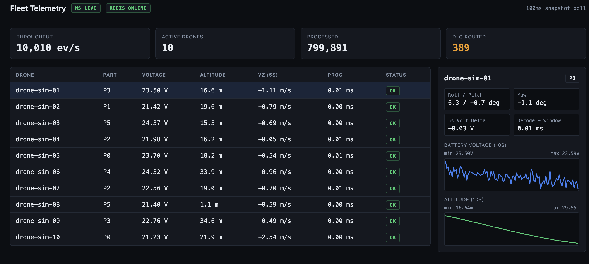

# Fleet Telemetry Streaming Pipeline

Event-driven telemetry pipeline built with Python, Apache Kafka, Redis, FastAPI, and React to ingest, process, and visualize real-time UAV flight data at 15,000+ events/sec.



## Why I Built This

I originally built this to track live IMU, barometer, and battery telemetry from my custom quadcopter. Because Wi-Fi drops out past 50–100 meters, the drone sends bandwidth-throttled MAVLink packets over its long-range control antenna instead. Once single-drone tracking worked, I scaled the backend to handle a simulated fleet—routing data across a 6-partition Kafka topic with manual offset commits and a dead-letter queue, running 5-second `deque` sliding windows to catch sudden voltage drops and rapid descents in under 50 ms, and caching state in Redis behind a FastAPI WebSocket gateway that polls at 100 ms so the browser stays responsive.

## Quick Start

Start Kafka, Redis, and the Python services:

```bash
docker compose up -d
python3 -m venv .venv && source .venv/bin/activate
pip install -r requirements.txt

uvicorn gateway.server:app --host :: --port 8000
python consumer/worker.py
python sim/fleet_sim.py --drones 10 --rate 1000
```

Start the dashboard:

```bash
cd dashboard && npm install && npm run dev
```